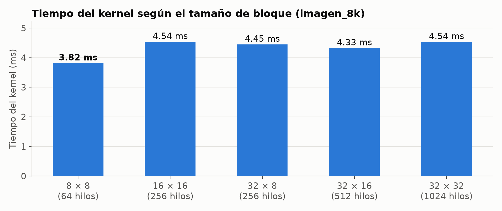
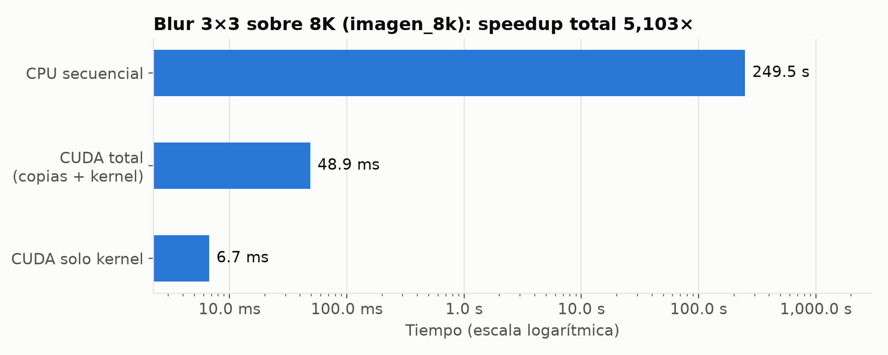
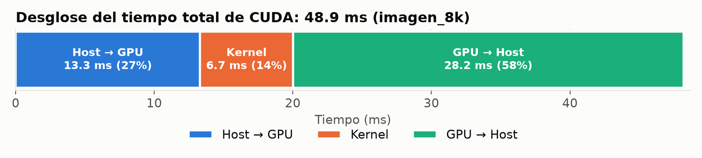
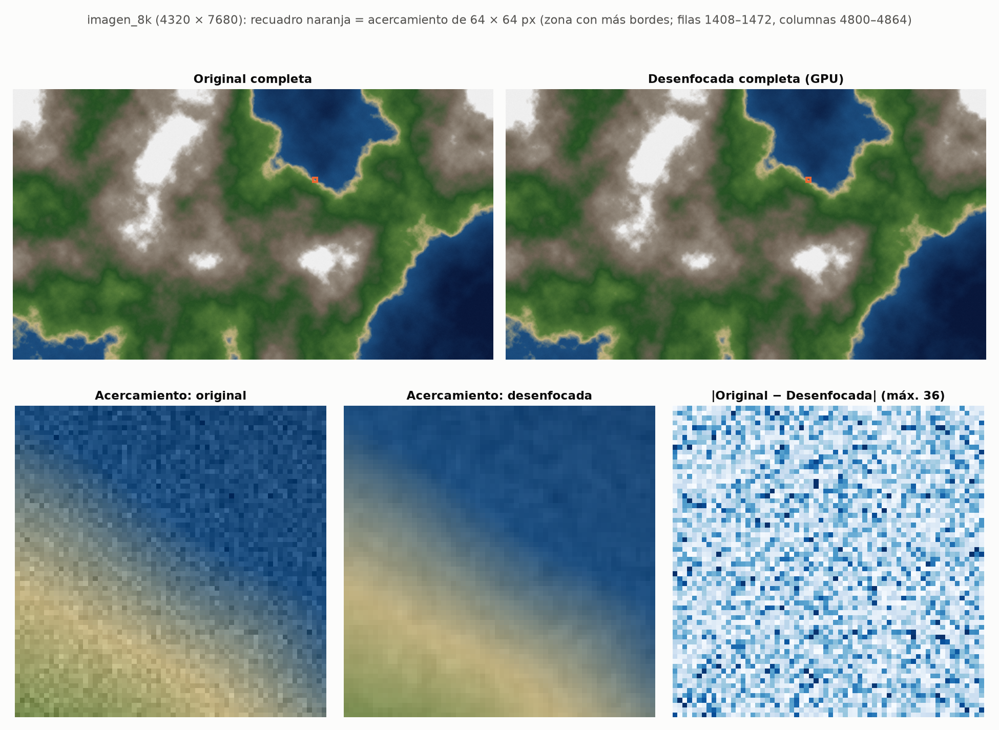
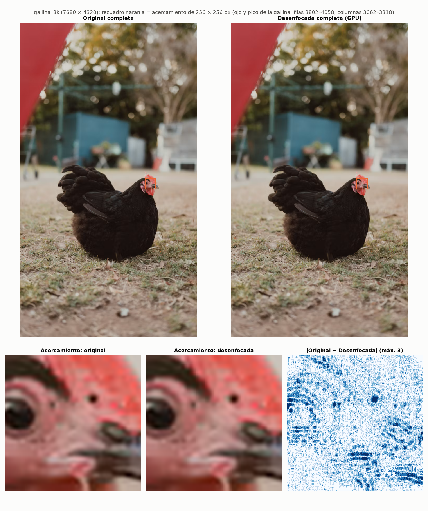

# Práctica Guiada 5: Paralelizando algoritmos con CUDA

**CC3069 · Computación Paralela y Distribuida**
Integrantes: Leonardo Mejía (`DufreyM`), María José (`tismajo`), Isabella (`Isabella1911`)
Algoritmo elegido: **Filtro de desenfoque de imagen (blur) 3×3**

---

## II. Preparación del entorno de trabajo

**¿Les funcionó el set up del env local o debieron utilizar alguna alternativa? ¿Cuál utilizaron?**

Trabajamos en local, con una GPU propia, sin usar Google Colab. El equipo no tenía conda, así que en lugar de
`conda create` usamos un entorno virtual de Python (`venv`) con `pip`:

```powershell
python -m venv cuda_env
cuda_env\Scripts\Activate.ps1
pip install -r requirements.txt     # numpy<2.4, numba-cuda[cu12], pillow, matplotlib
python -c "from numba import cuda; cuda.detect()"
```

En vez de `cudatoolkit` instalamos `numba-cuda[cu12]`, como en la guía de Colab. Este paquete trae por pip las
librerías de CUDA que necesita (NVRTC, runtime, nvJitLink), así que no hace falta instalar el CUDA Toolkit
completo. `cuda.detect()` reconoció la GPU como `[SUPPORTED]`.

**Problema encontrado:** con la versión más reciente de NumPy (2.5), la primera compilación de un kernel fallaba
con `AttributeError: module 'numpy' has no attribute 'row_stack'`. `numba-cuda` 0.30.4 todavía usa esa función,
que NumPy eliminó en la versión 2.4. Lo resolvimos fijando `numpy<2.4` (quedó la 2.3.5).

| Componente | Versión |
|---|---|
| GPU | NVIDIA GeForce RTX 4060 Laptop, 8 GB, compute capability 8.9, driver 581.42 (CUDA 13.0) |
| CPU | Intel Core i9-13900HX (24 núcleos / 32 hilos); la versión secuencial usa solo uno |
| Python | 3.14.5 |
| Librerías | numba 0.68.1, numba-cuda 0.30.4, numpy 2.3.5, pillow 13.0.0, matplotlib 3.11.2 |

---

## III. Identificación del algoritmo secuencial

### Diagrama de flujo


Fuente editable: [`diagramas/blur_secuencial.drawio`](diagramas/blur_secuencial.drawio)

### Tabla del algoritmo

| | |
|---|---|
| **Nombre del algoritmo elegido** | Filtro de desenfoque de imagen (box blur 3×3) |
| **Justificación de la selección** | Es un problema SIMD claro: se aplica la misma operación (promediar una ventana de 3×3) a cada uno de los 33 millones de píxeles, y cada píxel del resultado se calcula sin depender de los demás. Eso permite asignar un hilo por píxel, sin sincronización entre hilos y sin condiciones de carrera, porque cada hilo escribe solo su propio píxel. Además, una imagen se mapea de forma natural a una grid 2D, lo que nos permitió practicar la configuración de bloques y grid en dos dimensiones. |
| **Datos de entrada** | Imagen `I` de 4320 × 7680 píxeles RGB: un arreglo de 4320 × 7680 × 3 valores `uint8` (0–255). |
| **Datos de salida** | Imagen `R` de las mismas dimensiones y tipo, donde cada valor es el promedio redondeado de la ventana 3×3 centrada en ese píxel, para ese canal. |
| **Operaciones y procesos** | Para cada píxel `(y, x)` y cada canal `c`: (1) recorrer los 9 vecinos `(y+dy, x+dx)` con `dy, dx ∈ {−1, 0, 1}`; (2) en los bordes, llevar el índice al rango válido con *clamp*: `min(max(i, 0), n−1)`, lo que equivale a replicar el píxel de la orilla; (3) sumar los 9 valores; (4) dividir entre 9 redondeando al entero más cercano con aritmética entera: `(suma + 4) // 9`; (5) escribir el resultado en `R`, sin sobrescribir `I`. |

**Decisiones de diseño:**
- **Bordes:** el enunciado no especifica qué hacer en los bordes. Elegimos replicar el píxel de la orilla porque así
  todos los píxeles se dividen entre 9 y todos los hilos de la GPU hacen exactamente el mismo trabajo, sin casos
  especiales.
- **Redondeo:** usamos `(suma + 4) // 9` en lugar de `round(suma / 9)`, porque `round` de Python redondea al par en
  los empates (*banker's rounding*). Con aritmética entera, la CPU y la GPU dan resultados idénticos bit a bit, y
  eso nos permitió verificar la versión CUDA comparando ambas imágenes con `np.array_equal`.

### Implementación secuencial

**Archivo:** [`blur_secuencial.py`](blur_secuencial.py). La imagen de entrada se genera con [`generar_imagen.py`](generar_imagen.py).

La implementación es propia, con ciclos de Python y sin vectorización ni paralelismo: no usa `scipy.ndimage`,
OpenCV ni las operaciones vectorizadas de NumPy para el filtro. Sigue el diagrama con cinco ciclos anidados
(`y`, `x`, `c`, `dy`, `dx`).

Una optimización que no cambia el algoritmo: en cada fila `y`, las 3 filas que toca la ventana se convierten a
listas de Python. Indexar listas es aproximadamente el doble de rápido que indexar un arreglo de NumPy elemento por
elemento: medimos unos 4 min contra unos 8 min estimados para 8K. Además, convertir solo 3 filas evita cargar la
imagen completa como listas anidadas, que ocuparía varios GB de RAM.

### Conjunto de datos

| | |
|---|---|
| **Cantidad de datos** | 33 177 600 píxeles × 3 canales = **99 532 800 valores** |
| **Dimensiones** | **4320 × 7680 × 3** (alto × ancho × canales RGB), resolución 8K UHD |
| **Tamaño total en memoria** | **99 532 800 bytes ≈ 94.92 MiB** (1 byte por valor) |
| **Trabajo** | 99 532 800 valores × 9 lecturas ≈ **896 millones de sumas** |

Usamos dos imágenes del mismo tamaño:
1. **`imagen_8k`** (principal): imagen sintética de 7680 × 4320 con aspecto de foto satelital (agua, costa,
   vegetación, montaña y nieve). Se genera con ruido fractal y una semilla fija, así cualquiera puede reproducirla
   ejecutando `python generar_imagen.py`.
2. **`gallina_8k`**: una foto real de [Unsplash](https://unsplash.com) (`imagenes/gallina.png`, 800 × 1200), ampliada a 4320 × 7680
   (vertical). Tiene la misma cantidad de píxeles y bytes que la principal. Sirve para comprobar que el tiempo no
   depende del contenido de la imagen.

---

## IV. Creación de la solución paralela usando CUDA

**Archivo:** [`blur_cuda.py`](blur_cuda.py)


### Transferencia Host → GPU

**¿Cómo están organizados y representados los datos de entrada de su algoritmo?**

La imagen es un arreglo NumPy tridimensional `I[y, x, c]` de forma `(4320, 7680, 3)` y tipo `uint8`. Se guarda en
memoria contigua en orden de filas (*row-major*, orden C): primero la fila 0 completa, luego la fila 1, y así
sucesivamente. Dentro de cada fila, los píxeles van uno tras otro con sus 3 canales intercalados (R, G, B, R, G,
B…). El valor `I[y, x, c]` está en el byte `(y · 7680 + x) · 3 + c`. Al copiarlo a la GPU con `cuda.to_device`,
el `DeviceNDArray` mantiene la misma forma y la misma distribución en VRAM, así que el kernel lo indexa igual que
en la CPU.

**¿Cuánto tiempo tomó transferir los datos desde el Host hacia la GPU?**

```python
inicio = time.perf_counter()
d_I = cuda.to_device(I)
cuda.synchronize()
t_h2d = time.perf_counter() - inicio
```

**13.31 ms** (mediana de 10 corridas) para los 94.92 MiB, es decir unos **7.5 GB/s**. En la primera corrida fueron
13.51 ms. Antes de medir creamos el contexto CUDA con `cuda.get_current_device()`, para que su inicialización no se
sumara a la transferencia.

### Configuración de bloques y grid

**Si configuran bloques de 256 hilos y necesitan procesar un arreglo de 1,000,000 de elementos, ¿cuántos bloques
se requieren para cubrir todos los datos?**

⌈1 000 000 / 256⌉ = ⌈3906.25⌉ = **3907 bloques**. Eso da 3907 × 256 = 1 000 192 hilos. Los 192 hilos que sobran
en el último bloque deben descartarse con un `if (i < n)` dentro del kernel.

**¿Qué consideraciones tomarán en cuenta para definir el tamaño y la configuración de la Grid de su algoritmo?**

1. **Grid 2D, porque los datos son 2D.** Cada hilo corresponde a un píxel. `cuda.grid(2)` entrega `(x, y)` = (columna, fila).
2. **Bloque de 16 × 16 = 256 hilos.** Es múltiplo de 32 (el tamaño de un *warp*) y está por debajo del máximo de
   1024 hilos por bloque. Además, es lo bastante pequeño para que cada multiprocesador mantenga varios bloques
   activos al mismo tiempo, lo que mejora la ocupación.
3. **Cubrir toda la imagen redondeando hacia arriba:** grid = (⌈W / 16⌉, ⌈H / 16⌉) = (⌈7680 / 16⌉, ⌈4320 / 16⌉)
   = **480 × 270 = 129 600 bloques**, es decir **33 177 600 hilos**, exactamente uno por píxel.
4. **Protección de bordes en el kernel:** `if x < W and y < H`. En la imagen 8K los dos lados son múltiplos de 16,
   pero con otros tamaños sí sobran hilos. En el recorte de prueba de 270 × 480 se lanzan 130 560 hilos para
   129 600 píxeles.
5. **Accesos a memoria agrupados (*coalesced*):** `x` (la columna) corresponde a la dimensión más rápida del bloque.
   Así, los hilos consecutivos de un warp leen píxeles consecutivos de la misma fila, que están en direcciones de
   memoria contiguas.

Comprobamos el efecto del tamaño de bloque midiendo solo el kernel (`--explorar-bloques`):



Todas las configuraciones quedan entre 3.8 y 4.5 ms. El kernel está limitado por el acceso a memoria, no por la
cantidad de hilos por bloque, así que mientras la grid cubra la imagen el tamaño del bloque importa poco.

### Kernel

```python
@cuda.jit
def blur_kernel(I, R):
    x, y = cuda.grid(2)  # índice global del hilo: x = columna, y = fila
    H, W, C = I.shape
    if x < W and y < H:  # los hilos sobrantes del último bloque no hacen nada
        for c in range(C):
            suma = 0
            for dy in range(-1, 2):
                yy = min(max(y + dy, 0), H - 1)
                for dx in range(-1, 2):
                    xx = min(max(x + dx, 0), W - 1)
                    suma += I[yy, xx, c]
            R[y, x, c] = (suma + 4) // 9  # suma / 9 redondeado, igual que en la CPU
```

**¿Qué operación(es)/función(es) del algoritmo seleccionado se ejecutarán dentro del kernel?**

El cuerpo de los dos ciclos externos de la versión secuencial (`for y`, `for x`). Esos dos ciclos desaparecen,
porque cada hilo ya representa un `(y, x)`. Dentro del kernel quedan:
- el ciclo de canales `c`
- la ventana 3×3 (`dy`, `dx`)
- el *clamp* de los índices
- la suma de los 9 valores
- la división redondeada entre 9
- la escritura en `R`

**¿Qué resultado generará cada hilo al ejecutar el kernel?**

Cada hilo calcula **un píxel completo de la imagen de salida**: los 3 valores `R[y, x, 0]`, `R[y, x, 1]` y
`R[y, x, 2]`, que son el promedio redondeado de su ventana 3×3 en cada canal. Para eso lee 27 valores de `I` (9
vecinos × 3 canales) y escribe 3 en `R`. Ningún hilo escribe en la posición de otro, así que no hacen falta
operaciones atómicas ni barreras de sincronización.

### Transferencia GPU → Host

**¿Qué instrucción o método de CUDA Python permite copiar los resultados desde la GPU hacia el Host?**

El método **`copy_to_host()`** del arreglo en el dispositivo: `R = d_R.copy_to_host()`. También acepta un arreglo de
destino ya reservado, por ejemplo `d_R.copy_to_host(destino)`.

**¿Cuánto tiempo tomó transferir los resultados desde la GPU hacia el Host?**

```python
cuda.synchronize()                 # el kernel ya terminó
inicio = time.perf_counter()
R = d_R.copy_to_host()
t_d2h = time.perf_counter() - inicio
```

**28.18 ms** (mediana de 10 corridas). Es más del doble que la copia de ida, aunque se mueve la misma cantidad de
datos. Lo investigamos con [`experimento_memoria.py`](experimento_memoria.py):

| Variante | Tiempo |
|---|---|
| `copy_to_host()` a un arreglo **nuevo** (lo que mide `blur_cuda.py`) | 33.76 ms |
| `copy_to_host(destino)` a un arreglo **ya reservado** | 10.06 ms |
| `copy_to_host(fijada)` a memoria **pinned** | 7.59 ms |
| Host → GPU desde memoria normal (pageable) | 13.39 ms |
| Host → GPU desde memoria pinned | 11.28 ms |

La diferencia viene de que `copy_to_host()` sin argumento reserva un arreglo nuevo de 95 MB en cada llamada. La
primera vez que se escribe en esas páginas de memoria, el sistema operativo tiene que asignarlas, y ese costo de
unos 24 ms se suma a la copia. Con un arreglo reutilizado, la copia de regreso baja a unos 10 ms, comparable a la de
ida. Con memoria *pinned*, que el driver puede transferir por DMA sin una copia intermedia, ambas direcciones son
más rápidas.

---

## VI. Discusión de resultados y conclusiones

### Resultados

Para las fases CUDA se reporta la mediana de 10 corridas, después de una primera corrida que incluye la
compilación JIT del kernel (ver abajo). El tiempo de CPU es una sola corrida, porque cada una tarda unos 4 minutos.

| Imagen | t_CPU | t_H2D | t_kernel | t_D2H | **t_CUDA total** | **Speedup** | ¿Resultado idéntico? |
|---|---|---|---|---|---|---|---|
| `imagen_8k` (sintética) | 249.50 s | 13.31 ms | 6.71 ms | 28.18 ms | **48.90 ms** | **5 103×** | Sí, bit a bit |
| `gallina_8k` (foto) | 235.16 s | 13.51 ms | 7.42 ms | 28.52 ms | **49.88 ms** | **4 715×** | Sí, bit a bit |

El total es la mediana de los totales de cada corrida, por eso puede diferir un poco de la suma de las medianas de
cada fase.



### ¿Cuál fue la aceleración obtenida?

Speedup = t_CPU / t_CUDA, con t_CUDA = t_H2D + t_kernel + t_D2H medido en cada corrida. Como t_CUDA usamos la
mediana de esas 10 sumas.

Imagen principal (`imagen_8k`):

$$\text{Speedup} = \frac{t_{CPU}}{t_{CUDA}} = \frac{249.50\ \text{s}}{0.04890\ \text{s}} \approx \mathbf{5\,103\times}$$

Foto (`gallina_8k`):

$$\text{Speedup} = \frac{235.16\ \text{s}}{0.04988\ \text{s}} \approx \mathbf{4\,715\times}$$

Si en lugar de eso se suman las medianas de cada fase, se obtiene 13.31 + 6.71 + 28.18 = 48.20 ms, es decir
249.50 / 0.04820 ≈ 5 176×. La diferencia no cambia la conclusión.

**Sí, la implementación paralela mejoró el rendimiento de forma muy marcada.** Un filtro que en CPU tarda más de 4
minutos se completa en menos de 50 ms en la GPU, incluyendo las dos transferencias, y el resultado es idéntico píxel
por píxel.

Para interpretar bien estas cifras:
- **No son solo hardware.** El speedup compara Python interpretado con código compilado y paralelo. Gran parte de
  la diferencia viene de que el intérprete de Python ejecuta cada una de las ~896 millones de sumas por separado. La
  otra parte viene de tener 33 millones de hilos en lugar de uno. Una versión en C secuencial sería mucho más rápida
  que la de Python, y el speedup frente a ella sería menor.
- **Las transferencias dominan.** De los 48.9 ms de CUDA, solo **6.7 ms (14 %) son cálculo**. El 86 % restante se va
  en mover los datos entre la RAM y la VRAM, como advierte el enunciado. Contando solo el kernel, el speedup sería
  de unos **37 000×**.

  

  El blur es un cálculo ligero (9 sumas por valor) sobre muchos datos, así que tiene poca intensidad aritmética. Si
  la imagen se usara una sola vez y el cálculo fuera aún más simple, la transferencia podría anular la ventaja. La
  GPU gana claramente cuando los datos se quedan en VRAM y se les aplican varias operaciones seguidas.
- **La primera corrida es mucho más lenta: 519.6 ms.** Su kernel tardó 477 ms porque Numba compila el kernel en
  la primera llamada (JIT). Si se mide solo una corrida en frío, el speedup cae a 249.50 / 0.5196 ≈ **480×**. Para
  un programa que procesa una sola imagen y termina, ese es el costo real. En un flujo que procesa muchas imágenes,
  la compilación se paga una sola vez.
- **El contenido de la imagen no influye.** Las dos imágenes tienen la misma cantidad de datos y dan tiempos de GPU
  prácticamente iguales (48.9 contra 49.9 ms). La diferencia de unos 6 % en la CPU (249.5 contra 235.2 s) se
  explica por la variación normal del procesador entre corridas largas (frecuencia turbo y temperatura) y por la
  actividad de fondo del sistema. El algoritmo hace exactamente las mismas operaciones con cualquier imagen.
- **Cómo mejorarlo:** reservar la memoria del resultado una sola vez y usar memoria *pinned* reduciría el tiempo
  total de unos 49 ms a unos 22 ms (11.3 + 3.2 + 7.6 ms en el experimento). Eso daría un speedup cercano a
  **11 000×**. Otra opción es usar memoria compartida (*shared memory*) para que cada bloque cargue su región de la
  imagen una sola vez, en lugar de que cada píxel se lea hasta 9 veces desde la memoria global.



En la imagen sintética, el filtro suaviza el ruido píxel a píxel y difumina la orilla entre el agua y la costa.

En la foto de la gallina, la figura muestra la imagen completa antes y después, y un acercamiento de 256 × 256 px a
su ojo y su pico. La foto original medía 800 × 1200 y se amplió 6.4 veces, así que ya era muy suave: un desenfoque de
3×3 sobre 8K cambia como máximo 3 niveles (de 255) en esa zona y casi no se nota a simple vista. El mapa de
diferencias muestra que el filtro sí actuó, sobre todo en los contornos del ojo, las fosas nasales y el pico. Con una
foto que ya fuera 8K de origen, el efecto se vería más, como pasa en la imagen sintética.



### ¿Cuál fue la principal dificultad que encontraron al transformar el algoritmo secuencial en una implementación paralela utilizando CUDA? Expliquen cómo lograron resolverla.

La principal dificultad fue **medir los tiempos de forma correcta**. La primera medición del kernel dio 477 ms,
70 veces más que las siguientes, y la copia de regreso tardaba el doble que la de ida. Esto se debía a tres causas:

1. **Ejecución asíncrona.** El lanzamiento de un kernel regresa de inmediato, antes de que la GPU termine. Sin
   `cuda.synchronize()`, el cronómetro mide solo el lanzamiento. Lo resolvimos sincronizando después de cada fase,
   antes de detener el cronómetro.
2. **Compilación JIT y creación del contexto.** Numba compila el kernel en su primera llamada, y el contexto CUDA
   se crea la primera vez que se usa la GPU. Lo resolvimos creando el contexto antes de medir y reportando la
   primera corrida por separado. Como resultado oficial usamos la mediana de 10 corridas, que además es menos
   sensible a valores atípicos que el promedio.
3. **El costo oculto de la memoria nueva.** `copy_to_host()` y `device_array_like()` reservan memoria nueva en
   cada llamada, y la primera vez que se usa esa memoria es más lenta. Lo diagnosticamos con un experimento
   separado ([`experimento_memoria.py`](experimento_memoria.py)) y lo documentamos como una optimización posible.

Una segunda dificultad fue **garantizar que la GPU calcule exactamente lo mismo que la CPU**, para poder verificar
el resultado sin depender de la vista. Usamos el mismo *clamp* de bordes y el mismo redondeo entero `(suma + 4) // 9`
en las dos versiones, y comparamos las imágenes completas con `np.array_equal`. Las dos imágenes resultaron
idénticas bit a bit.

Por último, en la preparación del entorno, `numba-cuda` era incompatible con NumPy 2.5 (`np.row_stack` eliminado).
Lo resolvimos fijando `numpy<2.4`.

---

## Cómo reproducir

```powershell
pip install -r requirements.txt
python generar_imagen.py                                  # data/imagen_8k.npy
python blur_secuencial.py                                 # ~4 min, data/imagen_8k_blur_cpu.npy
python blur_cuda.py --explorar-bloques                    # data/imagen_8k_blur_cuda.npy + verificación
python generar_imagen.py --desde imagenes/gallina.png --salida data/gallina_8k.npy
python blur_secuencial.py --entrada data/gallina_8k.npy
python blur_cuda.py --entrada data/gallina_8k.npy
python experimento_memoria.py
python analisis.py                                        # tablas y gráficas en resultados/
```

## Referencias

- Documentación de Numba CUDA: <https://nvidia.github.io/numba-cuda/>. Kernels, `cuda.grid`, `to_device`,
  `copy_to_host`, `pinned_array`.
- NVIDIA, *CUDA C++ Best Practices Guide*: memoria pinned, accesos *coalesced* y ocupación. <https://docs.nvidia.com/cuda/cuda-c-best-practices-guide/>
- Foto de prueba: Unsplash, archivo `photo-1792976724194-cc55b36a5219`, bajo la [Licencia de Unsplash](https://unsplash.com/license).
- Las implementaciones secuencial y CUDA son propias; no se basaron en código existente.
