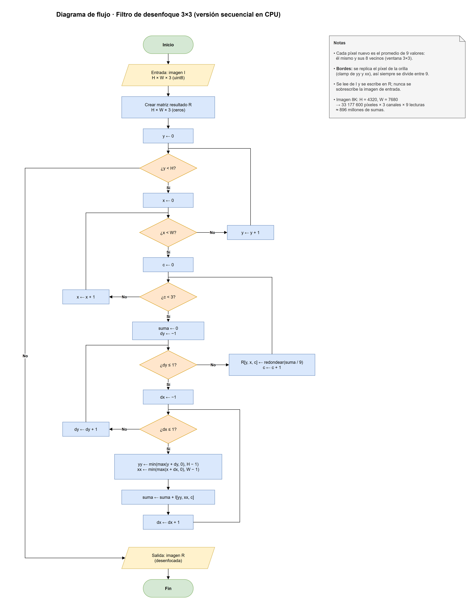
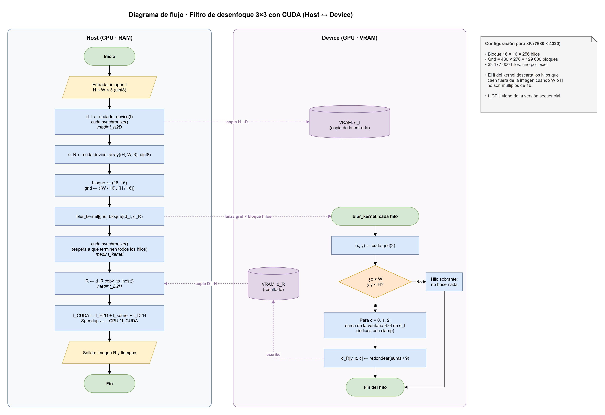

# CC3069 · Práctica Guiada 5: Paralelizando algoritmos con CUDA

Algoritmo elegido: **Filtro de desenfoque (blur) 3×3** sobre una imagen 8K (7680 × 4320, RGB).
Cada píxel del resultado es el promedio de sí mismo y sus 8 vecinos inmediatos; en los bordes se
replica el píxel de la orilla (clamp).

## Estructura

| Carpeta / archivo | Contenido |
|---|---|
| `generar_imagen.py` | Genera la imagen de entrada 8K en `data/` (sintética o a partir de una foto) |
| `diagramas/` | Diagramas de flujo en formato draw.io (`.drawio`) |
| `requirements.txt` | Dependencias de Python |
| `data/` | Imágenes y tiempos generados (no se sube al repo) |

## Cómo correr

```powershell
python generar_imagen.py              # imagen sintética 8K en data/imagen_8k.npy
```

### Datos de entrada

| | |
|---|---|
| Dimensiones | 4320 × 7680 × 3 (alto × ancho × canales RGB) |
| Cantidad de datos | 33 177 600 píxeles = 99 532 800 valores `uint8` |
| Tamaño en memoria | 99 532 800 bytes ≈ 94.92 MiB |

La imagen por defecto es sintética, con aspecto de foto satelital: ruido fractal con semilla fija, así todos generan la misma imagen.
Con `--desde` se puede usar una foto: se recorta al centro a 16:9 (o 9:16 si es vertical) y se lleva a 8K.
Una foto vertical queda en 7680 × 4320, con la misma cantidad de píxeles y bytes.

## Entorno

GPU usada: NVIDIA GeForce RTX 4060 Laptop (compute capability 8.9).

```powershell
python -m venv C:\ruta\a\cuda_env
C:\ruta\a\cuda_env\Scripts\Activate.ps1
pip install -r requirements.txt
python -c "from numba import cuda; cuda.detect()"
```

`numpy` se fija en `<2.4` porque `numba-cuda` todavía usa `np.row_stack`, que fue eliminado en NumPy 2.4.

## Diagramas

Se abren con [app.diagrams.net](https://app.diagrams.net) o con la extensión *Draw.io Integration* de VS Code.

Los `.drawio` se generan con `python diagramas/gen_diagramas.py` (requiere `pillow` solo para la opción `--preview`).
Si editan un diagrama a mano en draw.io, ya no lo regeneren con el script o se perderán los cambios.

Para exportar de nuevo a PNG con draw.io Desktop:

```powershell
& "$env:LOCALAPPDATA\Programs\draw.io\draw.io.exe" --export --format png --scale 2 --border 20 --output diagramas/blur_secuencial.png diagramas/blur_secuencial.drawio
```

### Algoritmo secuencial en CPU (sección III)

Fuente editable: [`diagramas/blur_secuencial.drawio`](diagramas/blur_secuencial.drawio)



### Flujo con CUDA: Host ↔ Device (sección IV)

Fuente editable: [`diagramas/blur_cuda.drawio`](diagramas/blur_cuda.drawio)


